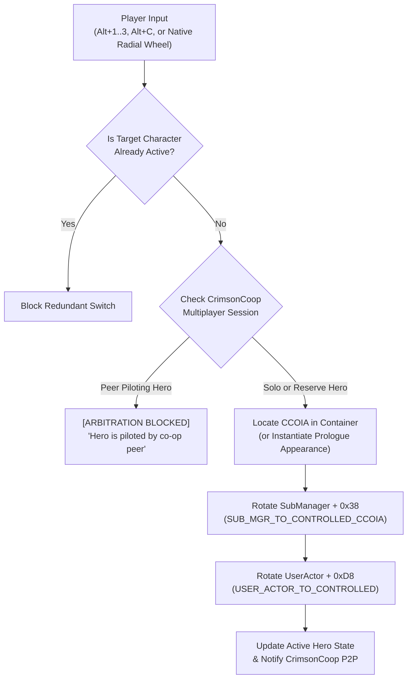

# CrimsonSwitch

[](https://en.cppreference.com/w/cpp/20)
[](https://docs.microsoft.com/en-us/windows/win32/direct3d12/direct3d-12-graphics)
[](https://store.steampowered.com/)
[](LICENSE)
[](https://github.com/Azteriisk/CrimsonSwitch)

> [!WARNING]
> ### ⚠️ PROJECT STATUS: PRE-ALPHA / EXPERIMENTAL RESEARCH (WIP)
> **THIS MOD DOES NOT CURRENTLY WORK AS INTENDED IN-GAME.**
>
> While the memory injection, signature scanning, hotkey listening, and top-right status watermark badge work reliably, **in-game character swapping is currently blocked by proprietary BlackSpace Engine companion spawning mechanics**:
> - **In-Game Radial Wheel:** Allocates slots for Damiane & Oongka, but displays them as **locked gray helmets** without active portraits.
> - **In-Game Character Swapping:** Pressing `Alt+1/2/3` updates the top-right overlay badge, but **does not transfer camera, character model, or controls** because the companion actor pointers (`CCOIA`) remain uninstantiated (`actor == NULL`) prior to story campaign recruitment.
>
> **We are actively seeking reverse engineers, game hackers, and BlackSpace Engine modders to help solve companion actor instantiation!** See the [Reverse Engineering Status & Call for Help](#reverse-engineering-status--call-for-help) section below.

**CrimsonSwitch** is an open-source reverse-engineering and character switching framework for *Crimson Desert*. In vanilla gameplay, switching between the three canon Greymane mercenaries—**Kliff**, **Damiane**, and **Oongka**—is gated behind mid-to-late campaign milestones and quest completion flags.

The goal of CrimsonSwitch is to override the BlackSpace Engine's character gating in RAM to allow playing as Kliff, Damiane, or Oongka from the prologue with direct hotkey switching, native in-game radial wheel support, and zero permanent modifications to game files on disk.

---

## Current Status & Feature Matrix

| Subsystem / Feature | Status | Notes |
| :--- | :---: | :--- |
| **RAM Injection Launcher** | ✅ **WORKING** | Clean launch & hot-attach (~100ms) into `CrimsonDesert.exe` without disk modifications. |
| **Visual Watermark Badge** | ✅ **WORKING** | Top-right click-through transparent Win32 overlay showing active hero & mod status. |
| **AOB Signature Scanning** | ✅ **WORKING** | Resolves `GameInstanceGlobal`, `EngineWorldGlobal`, and companion manager routines. |
| **Hotkey Interception** | ✅ **WORKING** | `Alt+1/2/3` and `Alt+C` intercept cleanly; passes normal `1/2/3/Tab` combat keys through. |
| **Radial Wheel Slot Allocation** | ⚠️ **PARTIAL** | Allocates 3 companion entries, but portraits render as locked gray helmets. |
| **In-Game Character Model Swap** | ❌ **BLOCKED** | Engine does not transfer camera/controls because companion `actor` pointers are `NULL`. |
| **Prologue Actor Instantiation** | ❌ **BLOCKED** | Native routine `SpawnOrUnlockCompanion` fails to instantiate 3D actors early in the story. |
| **Co-Op Arbitration Protocol** | 🟡 **STUBBED** | State machine designed; pending CrimsonCoop live synchronization. |

---

## Architectural Design & Capabilities

### 1. Instant Prologue Unlock Pipeline (In Progress)
* Targets the BlackSpace Engine companion management system (`CompanionContainer` in `EngineWorldGlobal + 0x30 -> +0x1230 -> +0x90`).
* AOB scanning dynamically locates `SpawnOrUnlockCompanion` (`0xa7dc20`), `FindCompanionById` (`0xa7d7f0`), and `SelectOrActivateCompanion` (`0xa8ed30`).
* NOP patch bypasses the 6-byte story progression branch at `SpawnOrUnlockCompanion + 0x35`.
* *Current state:* Companion entries register, but engine actor factory instantiation is still under reverse-engineering.

### 2. Direct Hotkey Swapping (Implemented & Active)
To ensure combat actions (potions, consumables, and quick items on `1`/`2`/`3`, and target lock-on on `Tab`) are **never hijacked or delayed**, CrimsonSwitch intercepts hotkeys cleanly via `GetAsyncKeyState` with the `ALT` modifier by default:
* `[Alt + 1]` $\rightarrow$ Switch to **Kliff**
* `[Alt + 2]` $\rightarrow$ Switch to **Damiane**
* `[Alt + 3]` $\rightarrow$ Switch to **Oongka**
* `[Alt + C]` $\rightarrow$ Cycle to Next Mercenary
*(When Alt is NOT pressed, your `1`, `2`, `3`, and `Tab` keys pass straight through to the game with zero latency! Note: Currently updates the on-screen watermark badge while actor spawning is being solved).*

### 3. Native Controller & Radial Wheel Integration (Under Development)
Once actor instantiation is unlocked, players using controllers or keyboards will be able to switch heroes anytime using the native in-game **Character Selection Radial Wheel** (holding `C` or Gamepad D-pad), in addition to keyboard hotkeys.

### 4. Zero-Footprint Standalone Launcher (`CrimsonSwitchLauncher.exe`) (Implemented & Active)
* **Zero Disk Footprint:** Game files on disk are **never modified**.
* **Hot-Attach Mode (~100ms):** Launch *Crimson Desert* normally through Steam. Once in-game, double-click `CrimsonSwitchLauncher.exe` to attach into the running process in ~100ms.
* **Clean Launch Mode:** Launches the game from scratch, waits 2 seconds for engine runtime initialization, and injects the DLL into RAM.
* **Vanilla Guarantee:** When launched directly from Steam without the launcher, your game remains 100% pure vanilla with achievements and original saves intact.

### 5. Seamless Co-Op Compatibility (`CrimsonCoop`)
CrimsonSwitch is built from the ground up to interoperate with [CrimsonCoop](https://github.com/Azteriisk/CrimsonCoop):
* **Solo Play:** Switch freely between all 3 heroes anytime.
* **3-Player Co-Op:** Real-time arbitration guards prevent switching to a hero currently piloted by a peer, preventing character clone desyncs.
* **2-Player Duo Co-Op:** Hotkeys automatically interface with CrimsonCoop's **Reserve Slot** system: either player can 1-key swap into the 3rd reserve mercenary, cycling their previous hero into reserve for their partner.

---

## Technical Architecture



---

## Configuration (`CrimsonSwitch.ini`)

All keys and behaviors are fully configurable in `CrimsonSwitch.ini`:

```ini
[General]
; Force unlock Kliff, Damiane, and Oongka on the radial wheel
UnlockAllFromStart = true

; Enable direct keyboard hotkeys
EnableDirectHotkeys = true

; Automatically spawn companion appearances during early prologue
SpawnMissingCompanions = true

[Hotkeys]
; RequireModifier protects 1/2/3/Tab combat keys
; ModifierKey: 0x12 = ALT, 0x11 = CTRL, 0x10 = SHIFT, 0x00 = None
RequireModifier = true
ModifierKey = 0x12

; Hotkeys when Modifier is held (Default: Alt+1, Alt+2, Alt+3, Alt+C):
KeyKliff = 0x31      ; '1'
KeyDamiane = 0x32    ; '2'
KeyOongka = 0x33     ; '3'
KeyCycleNext = 0x43  ; 'C'

; Alternative: Dedicated Function Keys (Set RequireModifier = false)
; KeyKliff = 0x75    ; F6
; KeyDamiane = 0x76  ; F7
; KeyOongka = 0x77   ; F8
; KeyCycleNext = 0x78; F9

; Alternative: Numpad Keys (Set RequireModifier = false)
; KeyKliff = 0x61    ; Numpad 1
; KeyDamiane = 0x62  ; Numpad 2
; KeyOongka = 0x63   ; Numpad 3
; KeyCycleNext = 0x60; Numpad 0

[Advanced]
DebugLogging = true
AllocateConsole = false
```

---

## Project Structure

```
CrimsonSwitch/
├── CMakeLists.txt                 # CMake build script (FetchContent MinHook + C++20)
├── CrimsonSwitch.ini              # Runtime configuration & hotkey bindings
├── README.md                      # Documentation & architecture manual
├── docs/
│   └── Early_Unlock_Architecture.md # BlackSpace Engine reverse engineering notes
├── include/
│   ├── Common.hpp                 # CharacterType enum & string helpers
│   ├── Config.hpp                 # INI settings reader & writer
│   ├── EngineTypes.hpp            # BlackSpace struct offsets & appearance paths
│   ├── EarlyUnlockHook.hpp        # MinHook IsCharacterUnlocked & WNDPROC hook
│   ├── Logger.hpp                 # Thread-safe diagnostic logging
│   ├── PatternScan.hpp            # Signature scanner with wildcard & RIP support
│   └── SwitchManager.hpp          # Memory bitmask forcing & CCOIA rotation
└── src/
    ├── main.cpp                   # 7-subsystem automated verification test harness
    ├── launcher.cpp               # Zero-footprint standalone memory injector
    ├── dllmain.cpp                # Runtime injected DLL entry point
    ├── Config.cpp                 # Configuration implementation
    ├── Logger.cpp                 # Logging implementation
    ├── PatternScan.cpp            # Signature scanning implementation
    ├── SwitchManager.cpp          # Character rotation & CrimsonCoop interop
    └── EarlyUnlockHook.cpp        # Window procedure & engine hook implementation
```

---

## Reverse Engineering Status & Call for Help

We have mapped several key functions, offsets, and structures inside `CrimsonDesert.exe` (BlackSpace Engine), but need community assistance to overcome the companion actor instantiation barrier.

### 1. Discovered Engine Functions & RVAs

| Routine | Verified RVA | AOB Signature | Purpose |
| :--- | :--- | :--- | :--- |
| `SpawnOrUnlockCompanion` | `0xa7dc20` | `40 55 53 56 57 41 56 48 8D 6C 24 C9 48 81 EC A0 00 00 00 C5 F8 29 B4 24 90 00 00 00 8B DA 4C 8B F1 33 F6 48 8D 55 DF 48 8B 49 30` | Spawns companion actor, sets active byte `+0x30 = 1`, and enables radial slot `+0x35 = 0x101`. |
| `FindCompanionById` | `0xa7d7f0` | `40 53 48 83 EC 20 8B DA 48 8B F9 83 FA 01 72 3B 83 FA 04 77 36` | Finds or creates companion entry in `compContainer + 0x140`. |
| `SelectOrActivateCompanion` | `0xa8ed30` | `40 53 48 83 EC 20 8B DA 48 8B F9 E8` | Engine's native handler for radial wheel character selection. |

### 2. Memory Structure Layouts

#### `CompanionContainer` Pointer Chain
```
EngineWorldGlobal (base + 0x724B348)
  -> +0x30: SubWorld
      -> +0x1230: PlacementContext
          -> +0x90: CompanionContainer
```

#### `CompanionEntry` (Inside `CompanionContainer + 0x140`, Stride `0x58`)
- `+0x00` (`uint32_t`): Character ID (`1` = Kliff, `2` = Damiane, `3` = Oongka)
- `+0x30` (`uint8_t`): Active / Registered flag
- `+0x34` (`uint8_t`): Selection state
- `+0x35` (`uint16_t`): Radial wheel availability (`0x0101` enables slot)
- `+0x38` (`uintptr_t`): **Pointer to `CCOIA` (Character Controller Object In-world Actor)**

### 3. The Core Roadblock

1. **The Story Progression Check:**  
   Inside `SpawnOrUnlockCompanion` at `0x140a7dc20 + 0x35`:
   ```assembly
   0F 84 23 01 00 00   je 0x140a7dd7e   ; Skips actor instantiation if story progression is not met
   ```
   Even when bypassed with 6 NOPs (`90 90 90 90 90 90`), the subsequent call to the engine actor factory (`0x140a98410`) does not instantiate a valid `CCOIA` actor early in the game.
2. **Hollow Companion Entries:**  
   `FindCompanionById(compContainer, id, true)` allocates a `0x58`-byte entry in the container, but leaves `actor (+0x38) == 0`. When the radial wheel opens, the engine sees `actor == 0` and renders a disabled grey helmet.
3. **Camera & Input Rotation:**  
   Rotating `pa::ClientUserActor + 0xD8` and `SubManager + 0x38` to point to Damiane or Oongka fails because no valid actor instance exists in the live world partition to receive input or attach the camera.

### 4. How You Can Help

If you have experience with **Ghidra, IDA Pro, x64dbg, or Cheat Engine**, we would love your help investigating:
- [ ] What global state or story quest manager does `0x140a98410` query before it will successfully instantiate a companion mesh/actor?
- [ ] Can Damiane and Oongka's actor instances be force-spawned via the world actor placement manager (`SubWorld + 0x1230`) using their appearance XML descriptors:
  - `character/appearance/1_pc/2_phw/cd_phw_damian/cd_phw_damian_00000.app_xml`
  - `character/appearance/1_pc/1_phm/cd_phm_oongka/cd_phm_oongka_00000.app_xml`
- [ ] How does the engine's companion switch routine (`0xa8ed30`) safely transfer the camera director and input controller when a companion *is* legitimately unlocked?

**Join the effort:**
- Open an Issue or Discussion on [GitHub](https://github.com/Azteriisk/CrimsonSwitch/issues) tagged `reverse-engineering`.
- Pull Requests with disassembly findings, struct definitions, or memory hooks are warmly welcome!

---

## How to Test

### 1. Run the Automated Test Harness
The test harness simulates the BlackSpace engine state, validates the bitmask override, exercises the character switching cycle, and tests the CrimsonCoop arbitration guard without needing the game open:

```powershell
cd C:\Users\thera\code\CrimsonSwitch
cmake --build build
.\build\crimson_switch_harness.exe
```

### 2. Standalone Launcher
Run `CrimsonSwitchLauncher.exe` to attach into a running game or launch from scratch:

```powershell
.\build\CrimsonSwitchLauncher.exe
```

---

## Building from Source

### Prerequisites
* Windows 10/11 (64-bit)
* Clang / MSVC with C++20 support
* CMake 3.20+ and Ninja

```powershell
cd C:\Users\thera\code\CrimsonSwitch
cmake -B build -G "Ninja" -DCMAKE_BUILD_TYPE=Release
cmake --build build
```

---

## License

This project is licensed under the [MIT License](LICENSE).
