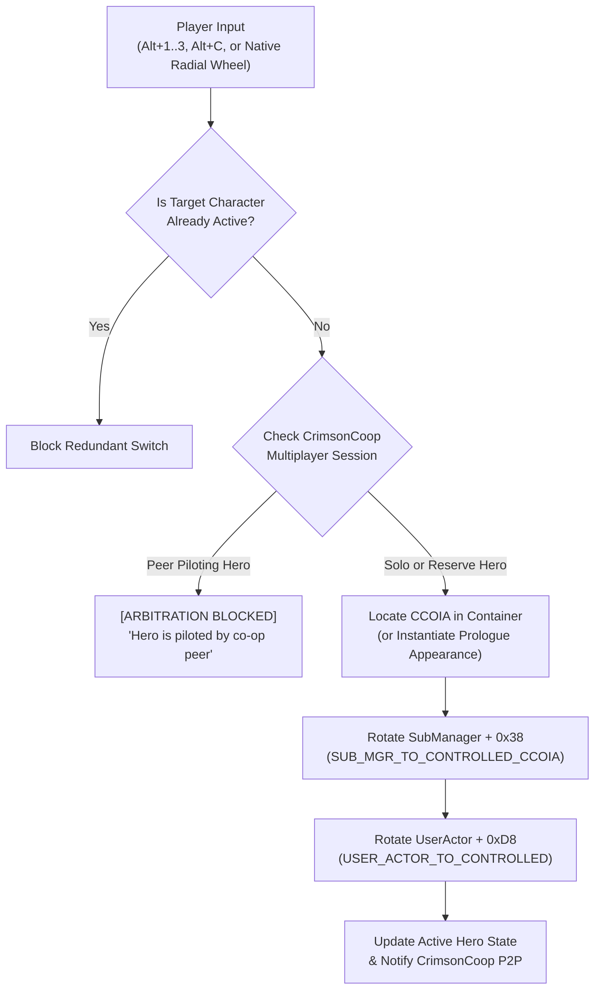

# CrimsonSwitch

[](https://en.cppreference.com/w/cpp/20)
[](https://docs.microsoft.com/en-us/windows/win32/direct3d12/direct3d-12-graphics)
[](https://store.steampowered.com/)
[](LICENSE)
[](https://github.com/Azteriisk/CrimsonSwitch/releases)

**CrimsonSwitch** is an instantaneous character unlock and direct switching mod for *Crimson Desert*. In vanilla gameplay, switching between the three canon Greymane mercenaries—**Kliff**, **Damiane**, and **Oongka**—is gated behind mid-to-late campaign milestones and quest completion flags. 

CrimsonSwitch overrides the BlackSpace Engine's character progression bitmask in RAM, unlocking all three mercenaries from the very first frame of the prologue with direct hotkey switching, native in-game radial wheel support, and zero permanent modifications to game files on disk.

---

## Key Features

### 1. Instant Prologue Unlock (All 3 Greymane Heroes)
* Overrides the BlackSpace Engine character unlock bitmask (`pa::ClientUserActor + 0x148 |= 0x0E`).
* Immediately illuminates and unlocks Damiane and Oongka on the in-game radial wheel from the start of the campaign.
* Dynamically instantiates protagonist appearance descriptors if companions are not yet recruited in the prologue:
  * Damiane: `character/appearance/1_pc/2_phw/cd_phw_damian/cd_phw_damian_00000.app_xml`
  * Oongka: `character/appearance/1_pc/1_phm/cd_phm_oongka/cd_phm_oongka_00000.app_xml`

### 2. Direct Hotkey Swapping (Gameplay Actions Protected)
To ensure combat actions (potions, consumables, and quick items on `1`/`2`/`3`, and target lock-on on `Tab`) are **never hijacked or delayed**, CrimsonSwitch uses the `ALT` modifier by default:
* `[Alt + 1]` $\rightarrow$ Switch to **Kliff**
* `[Alt + 2]` $\rightarrow$ Switch to **Damiane**
* `[Alt + 3]` $\rightarrow$ Switch to **Oongka**
* `[Alt + C]` $\rightarrow$ Cycle to Next Mercenary
*(When Alt is NOT pressed, your `1`, `2`, `3`, and `Tab` keys pass straight through to the game with zero latency!)*

### 3. Native Controller & Radial Wheel Support
Keyboard hotkeys are completely optional. Because CrimsonSwitch unlocks the character bitmask directly in engine memory, players using controllers or keyboards can switch heroes anytime using the native in-game **Character Selection Radial Wheel** (holding `C` or Gamepad D-pad).

### 4. Zero-Footprint Standalone Launcher (`CrimsonSwitchLauncher.exe`)
* **Zero Disk Footprint:** Game files on disk are **never modified**.
* **Hot-Attach Mode (~100ms):** Launch *Crimson Desert* normally through Steam. Once in-game, double-click `CrimsonSwitchLauncher.exe` to attach into the running process in ~100ms.
* **Clean Launch Mode:** Launches the game from scratch, waits 2 seconds for engine runtime initialization, and injects the DLL into RAM.
* **Vanilla Guarantee:** When launched directly from Steam without the launcher, your game remains 100% pure vanilla with achievements and original saves intact.

### 5. Seamless Co-Op Compatibility (`CrimsonCoop`)
CrimsonSwitch is built from the ground up to interoperate with [CrimsonCoop](https://github.com/Azteriisk/CrimsonCoop):
* **Solo Play:** Switch freely between all 3 heroes anytime.
* **3-Player Co-Op:** Real-time arbitration guards prevent switching to a hero currently piloted by a peer, preventing character clone desyncs.
* **2-Player Duo Co-Op:** Hotkeys automatically interface with CrimsonCoop's **Reserve Slot** system: either player can 1-key swap into the 3rd reserve mercenary, cycling their previous hero into reserve for their partner.

---

## Technical Architecture



---

## Configuration (`CrimsonSwitch.ini`)

All keys and behaviors are fully configurable in `CrimsonSwitch.ini`:

```ini
[General]
; Force unlock Kliff, Damiane, and Oongka on the radial wheel
UnlockAllFromStart = true

; Enable direct keyboard hotkeys
EnableDirectHotkeys = true

; Automatically spawn companion appearances during early prologue
SpawnMissingCompanions = true

[Hotkeys]
; RequireModifier protects 1/2/3/Tab combat keys
; ModifierKey: 0x12 = ALT, 0x11 = CTRL, 0x10 = SHIFT, 0x00 = None
RequireModifier = true
ModifierKey = 0x12

; Hotkeys when Modifier is held (Default: Alt+1, Alt+2, Alt+3, Alt+C):
KeyKliff = 0x31      ; '1'
KeyDamiane = 0x32    ; '2'
KeyOongka = 0x33     ; '3'
KeyCycleNext = 0x43  ; 'C'

; Alternative: Dedicated Function Keys (Set RequireModifier = false)
; KeyKliff = 0x75    ; F6
; KeyDamiane = 0x76  ; F7
; KeyOongka = 0x77   ; F8
; KeyCycleNext = 0x78; F9

; Alternative: Numpad Keys (Set RequireModifier = false)
; KeyKliff = 0x61    ; Numpad 1
; KeyDamiane = 0x62  ; Numpad 2
; KeyOongka = 0x63   ; Numpad 3
; KeyCycleNext = 0x60; Numpad 0

[Advanced]
DebugLogging = true
AllocateConsole = false
```

---

## Project Structure

```
CrimsonSwitch/
├── CMakeLists.txt                 # CMake build script (FetchContent MinHook + C++20)
├── CrimsonSwitch.ini              # Runtime configuration & hotkey bindings
├── README.md                      # Documentation & architecture manual
├── docs/
│   └── Early_Unlock_Architecture.md # BlackSpace Engine reverse engineering notes
├── include/
│   ├── Common.hpp                 # CharacterType enum & string helpers
│   ├── Config.hpp                 # INI settings reader & writer
│   ├── EngineTypes.hpp            # BlackSpace struct offsets & appearance paths
│   ├── EarlyUnlockHook.hpp        # MinHook IsCharacterUnlocked & WNDPROC hook
│   ├── Logger.hpp                 # Thread-safe diagnostic logging
│   ├── PatternScan.hpp            # Signature scanner with wildcard & RIP support
│   └── SwitchManager.hpp          # Memory bitmask forcing & CCOIA rotation
└── src/
    ├── main.cpp                   # 7-subsystem automated verification test harness
    ├── launcher.cpp               # Zero-footprint standalone memory injector
    ├── dllmain.cpp                # Runtime injected DLL entry point
    ├── Config.cpp                 # Configuration implementation
    ├── Logger.cpp                 # Logging implementation
    ├── PatternScan.cpp            # Signature scanning implementation
    ├── SwitchManager.cpp          # Character rotation & CrimsonCoop interop
    └── EarlyUnlockHook.cpp        # Window procedure & engine hook implementation
```

---

## How to Test

### 1. Run the Automated Test Harness
The test harness simulates the BlackSpace engine state, validates the bitmask override, exercises the character switching cycle, and tests the CrimsonCoop arbitration guard without needing the game open:

```powershell
cd C:\Users\thera\code\CrimsonSwitch
cmake --build build
.\build\crimson_switch_harness.exe
```

### 2. Standalone Launcher
Run `CrimsonSwitchLauncher.exe` to attach into a running game or launch from scratch:

```powershell
.\build\CrimsonSwitchLauncher.exe
```

---

## Building from Source

### Prerequisites
* Windows 10/11 (64-bit)
* Clang / MSVC with C++20 support
* CMake 3.20+ and Ninja

```powershell
cd C:\Users\thera\code\CrimsonSwitch
cmake -B build -G "Ninja" -DCMAKE_BUILD_TYPE=Release
cmake --build build
```

---

## License

This project is licensed under the [MIT License](LICENSE).
